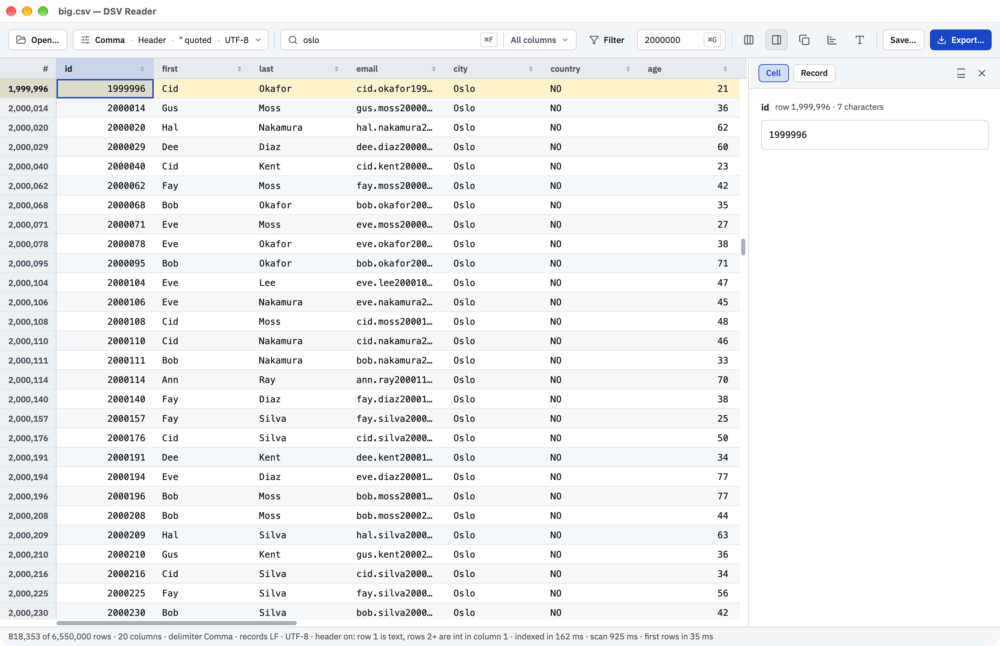

# DSV Reader

[](https://github.com/laminko/dsv-reader/actions/workflows/ci.yml)
[](https://github.com/laminko/dsv-reader/releases/latest)
[](LICENSE)

A native macOS app, written in Rust, that opens CSV, TSV, and other delimited files.
It shows the first rows of a 1.1 GB file in about 30 ms (see [Performance](#performance)).

DSV Reader is a port of [bb-plugin-dsv](https://github.com/laminko/bb-plugin-dsv) 0.10.1, with the same detection and type rules.
The window uses [gpui-kit](https://crates.io/crates/gpui-kit) 0.7.1.



The screenshot shows a synthetic file from `examples/gen.rs`. The names, cities, and email addresses are not real.

## Features

- **Large files:** The app maps the file into memory and parses only the rows on screen.
- **Detection:** The app finds the delimiter, the header row, the encoding, and the type of each column.
- **Search and filters:** Search all columns or only some. Filters use the column type and join with "and" or "or".
- **Sort:** Sort on one or more columns. Text sorts digit runs in number order.
- **Select and copy:** Select cells, rows, or columns, as in a spreadsheet. Copy gives tab-separated text.
- **Record viewer:** The full active cell, or the active row as a form.
- **Profile:** Statistics and a value distribution for each column. Also from the command line, as JSON.
- **Types and formats:** Set the type and the display format of each column.
- **Save and Export:** Export the rows that you see as CSV. Save the column order that you see.
- **Themes:** System, Light, and Dark. Zebra rows, dates in color, and zeros in grey.

## Install

### Download (Apple silicon)

The download is for Macs with Apple silicon (arm64).
It has an ad-hoc signature and Apple did not notarize it. For this reason, macOS blocks the first open.

1. Open the [latest release](https://github.com/laminko/dsv-reader/releases/latest).
2. Download `DSV-Reader-<version>-macos-arm64.zip`.
3. Double-click the zip file to unzip it.
4. Drag `DSV Reader.app` to the Applications folder.
5. Double-click `DSV Reader.app`. macOS does not open it and shows a dialog.
6. Click **Done**.
7. Open **System Settings** > **Privacy & Security**.
8. Scroll down to the **Security** section. Click **Open Anyway**.
9. In the dialog that opens, click **Open Anyway**.
10. Use Touch ID, or click **Use Password…**. If you use a password, type the name and password of an administrator.

On macOS 11 and 12, step 7 is **System Preferences** > **Security & Privacy**.
After the first open, macOS opens the app without a dialog.

### Build from source

You need macOS and Rust 1.95 or later. Xcode is not necessary, because the app compiles its Metal shaders when it starts.

1. If you do not have Rust 1.95 or later, install it with Homebrew:

   ```sh
   brew install rustup
   export PATH="$(brew --prefix rustup)/bin:$PATH"
   rustup default stable
   ```

   Homebrew does not add `rustup` to the `PATH`. To keep the `export` line, add it to `~/.zshrc`.

2. Get the source code:

   ```sh
   git clone https://github.com/laminko/dsv-reader.git
   cd dsv-reader
   ```

3. Build the app and open a file with it:

   ```sh
   cargo build --release
   target/release/dsv-reader path/to/file.csv
   ```

   The first build compiles about 450 crates.

4. To make a Mac app, run the bundle script:

   ```sh
   ./bundle.sh
   ```

   The script makes `target/release/DSV Reader.app`, with its icon and an ad-hoc signature. It does not install the app.

5. Drag `target/release/DSV Reader.app` to the Applications folder.

### Open With and the default app

If the app is in the Applications folder, Finder shows it in **Open With** for `.csv`, `.tsv`, `.tab`, `.psv`, `.dsv`, and `.ssv` files.
The app does not take the default from Numbers or Excel.
If no other app on the Mac claims a file type, macOS makes DSV Reader the default app for that type.

To make DSV Reader the default app for a file type:

1. In Finder, select a file of that type.
2. Choose **File** > **Get Info**.
3. In **Open with**, select **DSV Reader**.
4. Click **Change All**.

## Usage

### Open a file

You can open a file in these ways:

- Run the app with the file path: `target/release/dsv-reader path/to/file.csv`.
- Press ⌘O, or click **Open…**.
- Drag the file onto the window.
- If no file is open, double-click the empty window.
- In Finder, double-click the file, or use **Open With**.
- Drop the file on the Dock icon.

The last two ways need the app bundle.

If a file is already open, the app asks where to open the new file: **Current window** or **New window**.
**New window** starts a new instance of the app.

### Change how the app reads the file

The second button in the toolbar shows how the app reads the file, for example `Comma · Header · " quoted · UTF-8`.
Click this button to change these settings:

| Setting | Choices |
|---|---|
| Delimiter | Detected from `,`, tab, `;`, `\|`, and the file extension. You can select one, or type any single character. |
| Header row | Auto, On, or Off. For Auto, the status bar shows the reason. |
| Text qualifier | `"`, `'`, or none. |
| Encoding | Auto, or one of 12 encodings. Auto reads a UTF-16 byte order mark. Without one, it reads UTF-8. |

**Reset to auto** puts back the detected settings.

### Column types and formats

The app finds the type of each column from the first 1,000 rows: int, float, bool, date, datetime, time, or string.
Numbers and times align right.

To change the type or the format of a column:

1. Right-click the column name.
2. Under **Type**, select a type.
3. Under **Show**, select a format.

| Type | The app reads |
|---|---|
| Auto | The detected type |
| Text | Any text |
| Number | `1.5` or `1,5` (select one in **Read as**) |
| Date, Date & Time | `31/01/2024`, `01/31/2024`, or `2024-01-31` (select one in **Read as**). Also `5 Feb 2024`, `Feb 5, 2024`, and `20230505T090548` (year first). |
| Time | `14:05`, `2:05 PM`, `00:02:05.881533`, or `100:00:00` |
| Yes-No | Yes and no values |

The formats are: Number (thousands separator, decimals), Percent, Currency (symbol, decimals), Duration (`1:02:03` or `1h 2m 3s`), Date (4 patterns), Date & Time, Time of day (`14:05`, `14:05:09`, or `2:05 PM`), and Yes-No (`Yes`/`No` or `✓`/`×`).

- If a type that you set cannot read all cells, the menu shows the count, for example "Reads 0 of 744 values". The other cells show the text of the file.
- Formats change only the screen. Copy and Export write the text of the file.
- Types and formats reset when the file closes.
- A 2-digit year (`01/02/03`) reads only after you set the type to Date or Date & Time. Then select the order in **Read as**. Years 00–68 read as 2000–2068, and 69–99 as 1969–1999.
- A time, alone or after a date, can have AM or PM and a zone: `Z`, `+00`, `+0700`, or `+07:00`. The app ignores the zone.

### Find rows

- **Search:** Press ⌘F, then type. The search ignores case. To search only some columns, click **All columns** and select the columns.
- **Filter:** Click **Filter** to add a filter. Select a column, an operator, and a value. Click × to remove the filter.
- **Sort:** Click the arrow in a column name. Each click changes the sort: ascending, descending, off. To add a sort level, Shift+click the arrow of the next column.
- **Go to row:** Press ⌘G. Type a row number, then press Return. The app moves the row to the top, marks it, and makes it the active row.

Filter operators depend on the column type.
For text, they are: contains, equals (ignores case), is exactly (keeps case), starts with, is empty, and not empty.
Filters join with "and". To join with "or", click the word "and".
"and" binds first: `a and b or c` means `(a and b) or c`.

Text sort puts digit runs in number order and ignores case.
If filters hide the row that you go to, the app goes to the nearest row above it.

### Columns

- To show or hide columns, click the **Columns** button.
- To resize a column, drag the edge of its name.
- To fit a column, double-click the edge of its name. The width fits the longest value on screen and the name.
- To move a column, drag its name. A line shows where the column goes.
- To put back the file order, click **Columns** > **Reset order**.

### Select and copy

- Click a cell to make it the active cell. Use Shift+arrow keys to extend the selection.
- Click a row number to select the row. Click a column name to select the column.
- Press ⌘C to copy the selection as tab-separated text.
- To copy with the column names, click the **Copy** button > **Copy with column names**.

Copy takes up to 1,000,000 rows.

### Record viewer

Click the **Record viewer** button in the toolbar. The viewer has two tabs:

- **Cell** shows the full active cell and its character count.
- **Record** shows the active row as a form. The arrow buttons go to the first, previous, next, and last row.

In the **Record** tab, click a field to make its cell the active cell. Then ⌘C copies the cell.
To copy part of a field, drag over the text, then press ⌘C. A long field scrolls on its own.

To move the viewer, click **Move below** or **Move right**. To resize it, drag its edge.
The app keeps the side and the size.

### Profile

Click the **Profile** button (the chart icon) in the toolbar. The Profile shows one card for each column.
The Profile computes only the cards on the screen and the next card. The other cards compute when you scroll to them.

| Column type | Statistics |
|---|---|
| All types | count, empty, not empty, distinct, unique (seen once), repeated, most common value |
| Text | min and max (code-point order), shortest, longest, mean length |
| Number, Time | min, max, mean, median, standard deviation, sum |
| Date | earliest, latest, span |
| Yes-No | true, false |

Each card also shows the value distribution.
For numbers, dates, and times, it shows a histogram of 20 bars. For other types, it shows the top 10 values as bars.

- Click a value to filter its rows ("is exactly").
- Click a histogram bar to filter its range ("between").

The settings of the Profile are:

| Setting | Choices |
|---|---|
| Rows | **All** or **First 1,000**. The default is All up to 100,000 rows, and First 1,000 above. **Use search and filters** limits the rows. |
| Distinct | **Exact** or **Approximate**. The Profile recommends Approximate above 1,000,000 rows. |
| Columns | **All columns**, **None**, or one tick for each column. |

To profile one column, right-click its name, then click **Profile this column**.
If the Record viewer is also on the right, the two panes share the side. Drag the line between them to resize them.

### Profile from the command line

The app binary makes the Profile without a window, and writes it as one JSON object to the standard output.
Use it in a script or in a CI job on a Mac.

```sh
"/Applications/DSV Reader.app/Contents/MacOS/dsv-reader" profile FILE [--columns NAME,NAME] [--first N] [--approx]
```

| Option | Action |
|---|---|
| `--columns NAME,NAME` | Profile only these columns. The default is all columns. |
| `--first N` | Profile only the first N rows. The default is all rows. |
| `--approx` | Use Approximate for the distinct counts and the top values. The default is Exact. |

The app reads the file as it does in the window: it finds the delimiter, the header, the encoding, and the types.
Each column has the keys of its type: for example, `min`, `max`, `mean`, `median`, `std`, and `sum` for a number column, and `earliest` and `latest` for a date column.
Dates and times are text, as the app shows them. All other numbers are JSON numbers.

The exit code is 0 when the profile is complete.
It is 1 for a bad option or a column name that is not in the file. It is 2 when the app cannot read the file.

This example stops a CI job when the column `id` has a value two times. Here, `dsv-reader` is the program in the command above:

```sh
dsv-reader profile orders.csv --columns id | jq -e '.columns[0].unique == .columns[0].count'
```

For the 1.1 GB test file (20 columns), the profile of all columns took 9.9–12.6 s with Exact (6 runs) and 6.6–7.1 s with `--approx` (3 runs).

### Save and Export

**Export** (⌘S or **Export…**) writes the rows that you see to a UTF-8 CSV file.
It uses the search, the filters, and the sort, and it writes only the shown columns. It does not change the open file.

**Save…** writes the open file again, with the columns that you see, in the order that you see.
It writes every row, in file order. It keeps the delimiter, the record delimiter, and the text qualifier.

To save:

1. Click **Save…**.
2. Select **Overwrite** to replace the open file. To write a new file, select **Write a new file in the same folder** and type a name.
3. Click **Save**.

Save stops if the file changed on disk after the app read it (size or modified time).
Save also stops if the new name is in use.
The status bar shows "modified" until a Save writes the column order. If you quit with a modified order, the app asks first.

### Appearance

Click the **Font and size** button to set the grid font, the size (8–32 pt), and the theme (System, Light, or Dark).
**Zebra rows** puts every second row on a light tint. It is on by default.
The app keeps these settings after a restart.

The grid shows dates and dates with a time in a teal color. It shows a zero (`0`, `0.00`, `0:00:00`) in grey.
The row numbers are on a grey that is lighter than the column names.
For Thai, Myanmar, Chinese, and Korean text, the app uses system fonts.

If the window is narrow, the toolbar moves its controls on the right into a **⋯** menu.
The minimum window size is 640 × 400.

The status bar shows the rows, the index progress, the columns, the delimiter, the record delimiter, the encoding, and times.

### Keyboard shortcuts

| Key | Action |
|---|---|
| ⌘O | Open a file |
| ⌘F | Put the cursor in Search |
| ⌘G | Put the cursor in Go to row |
| ⌘S | Export the rows that you see as a CSV file |
| ⌘Q | Quit (the app asks first if the column order is not saved) |
| Arrow keys | Move the active cell |
| Shift+arrow keys | Extend the selection |
| Page Up, Page Down | Move one screen (Shift extends the selection) |
| ⌘A | Select all |
| ⌘C | Copy the selection |
| Esc | Clear the selection |

## Performance

Measured on 2026-10-07: release build, Apple silicon Mac, macOS 27.0.1, warm file cache.
The test file is synthetic: 1.1 GB, 6,550,000 rows × 20 columns.

| Measurement | Result |
|---|---|
| Open → first rows (4 runs) | 30.0–30.5 ms (52.6 ms in the first run after the build) |
| Full index (4 runs) | 160–162 ms |
| Full index of a file that is not in the file cache, after `sudo purge` (3 runs) | 918–955 ms |
| Draw time of a page scroll, p95 (31 rows a frame, 60 Hz display, 2 runs) | 4.9 ms |
| Peak memory, open and scroll | 207 MB |
| Search all columns | 489 ms |
| Search one column | 109 ms |
| Filter `age > 50` | 187 ms |
| First sort of a number column | 413 ms |
| First sort of a text column | 573 ms |
| Sort again (ranks cached) | 189 ms |
| Copy 10,000 rows × 20 columns as TSV | 23 ms |
| Export every row (1,101.7 MB) | 1,373 ms |
| Go to row 6,000,000 in rows sorted by age (3 runs) | 0.46–0.50 ms |
| Profile of all columns, Approximate | 7.6 s (first card at 0.65 s), peak 313 MB |
| Profile of all columns, Exact | 11.1 s (first card at 0.52 s), peak 368 MB |
| Profile, the cards on the screen (1600 × 1000 window), Exact (2 runs) | 0.72–0.74 s (2 of 20 columns, first card at 0.53–0.55 s), peak 366 MB |

The results from "Search all columns" to "Export every row" are the slower of 2 runs.
A first text sort alone (the email column) peaks at 326 MB. The full `--query` run peaks at 569 MB, with the export.
During a profile, the longest gap between frames was 27.4 ms (Approximate) and 33.2 ms (Exact).

To do these measurements on your Mac:

```sh
cargo run --release --example gen -- big.csv 6550000           # make the 1.1 GB test file
cargo build --release
DSV_BENCH=1 target/release/dsv-reader big.csv                  # open → first rows, full index
DSV_BENCH=1 DSV_SCROLL=1 /usr/bin/time -l target/release/dsv-reader big.csv  # draw times, peak memory
cargo run --release --example bench -- big.csv 1 --query       # search, filter, sort, copy, export
DSV_BENCH=1 DSV_SORT=6 DSV_GOTO=6000000 target/release/dsv-reader big.csv    # go to row in rows sorted by age
DSV_BENCH=1 DSV_PROFILE=all DSV_DISTINCT=approx /usr/bin/time -l target/release/dsv-reader big.csv
DSV_BENCH=1 DSV_PROFILE=all DSV_DISTINCT=exact /usr/bin/time -l target/release/dsv-reader big.csv
DSV_BENCH=1 DSV_PROFILE=all DSV_DISTINCT=exact DSV_CARDS=screen DSV_SIZE=1600x1000 /usr/bin/time -l target/release/dsv-reader big.csv
cargo build --release --example bench
/usr/bin/time -l target/release/examples/bench big.csv 0 --sort 3  # one text sort, peak memory
```

`/usr/bin/time -l` prints the peak memory as "peak memory footprint".

The app is fast for these reasons:

1. The app maps the file into memory. It never copies a UTF-8 file.
2. One pass with `memchr` finds the start of each record. The index keeps 8 bytes for each row.
3. The index runs on its own thread. The grid shows the rows of the first batch before the index is complete.
4. The app parses only the rows on screen. The grid paints only the rows and columns on screen.

## Development

```sh
cargo fmt --check
cargo clippy --all-targets -- -D warnings
cargo test                     # 106 tests: 95 in the library, 11 in the app
```

CI runs these checks on macOS for each push. Then it runs `cargo check` with Rust 1.95.
`rustfmt.toml` allows lines of up to 200 characters.

| File | Content |
|---|---|
| `src/lib.rs` | The parser, the index, detection, search, filters, sort, copy, the profile, and its JSON. No GUI. |
| `src/main.rs` | The window, and `dsv-reader profile` on the command line |
| `src/grid.rs` | The grid, painted by the app. The gpui-kit table drew a page scroll in 21.7–21.9 ms (p95). |
| `src/toolbar.rs` | The toolbar, its popovers, and its dialogs |
| `src/pane.rs` | The Record viewer, the Profile, and the filter rows |
| `src/menu.rs` | The column menu |
| `src/file.rs` | The settings, Save, and Export |
| `src/mac.rs` | The quit question in the app delegate, the title bar theme, and the Dock icon of the bare binary |
| `examples/gen.rs` | The synthetic test file |
| `examples/bench.rs` | Benchmarks without a window |

### Benchmarks

The commands for the [Performance](#performance) table are there. Two more commands use the same test file:

```sh
cargo run --release --example bench -- big.csv 3 --check            # index times, and index count = parse count
cargo run --release --example bench -- big.csv 0 --profile approx   # profile every column (or exact, and a column number for one)
```

### Test hooks

Set `DSV_BENCH=1` to print the times and quit. These variables add to it:

| Variable | Action |
|---|---|
| `DSV_SCROLL=1` | Scroll one page a frame, for 300 frames, in a 1600 × 1000 window. `DSV_FRAMES` sets the number of frames. |
| `DSV_SEARCH=text` | Search, then print the scan time and the rows. |
| `DSV_SORT=column` | Sort on that column (0 is the first), after the search. |
| `DSV_GOTO=row` | Go to that row, then print the time. |
| `DSV_COPY=rows` | Time a copy of the first rows, all columns, as TSV. The clipboard does not change. |
| `DSV_PROFILE=1000\|all\|auto` | Open the Profile, then print its time, the time of the first card, and the longest frame gap. `DSV_DISTINCT=exact\|approx` sets Distinct. It profiles every column. |
| `DSV_CARDS=screen` | With `DSV_PROFILE`: profile only the cards on the screen, as the app does. The report also gives the columns done and the cards on the screen. |
| `DSV_TOP=4`, `4,8`, `4\|8`, `9:3` | After `DSV_PROFILE`, filter on the most common value of column 4, as a click does. `,` joins with "and", `\|` with "or". `9:3` is bar 3 of column 9. |
| `DSV_HOLD=1` | Keep the window open after the report, for a screenshot. |

macOS throttles the frames of a window behind other windows. A window on another Space gets no frames. For this reason, the benchmarks wait until the window is in front.

These variables work without `DSV_BENCH`:

| Variable | Action |
|---|---|
| `DSV_THEME=light\|dark` | Start in that theme. The app does not save it. |
| `DSV_SIZE=WxH` | Start at that window size. |
| `DSV_VIEWER=0` | Start with the Record viewer closed. |
| `DSV_OPEN=parse\|scope\|columns\|font\|save` | Open that popover or the Save dialog, for a screenshot. |
| `DSV_PICK=path`, `DSV_OPEN_IN=current\|new` | After the first rows, send a file as Open does, and answer the "Open in" question. |
| `DSV_MODIFY=1` | Hide the last column. Then a quit asks first. |

## Limitations

- The app does not edit cells. Save writes the column order and the shown columns, not new values.
- Save writes UTF-8 and leaves out the hidden columns.
- To overwrite the open file, Save writes a new file and renames it. It does not copy the permissions or the extended attributes of the old file.
- Save finds a change on disk by the size and the modified time. It does not find a change that keeps both.
- Export and Save write the bytes of each cell as they are. A byte that is not UTF-8 does not change.
- The exact column count comes from a width pass after the index: 316–362 ms on the 1.1 GB file. Until then, the count comes from the first 1,001 rows.
- Text sort does not fold accents, and punctuation sorts by code point. The plugin used the ICU collator.
- A first sort of a text column needs memory: 326 MB peak for the email column of the 1.1 GB file.
- Exact distinct counts compare 64-bit hashes. For 6.5 million different values, the chance that two values count as one is about 1 in 1,000,000.
- The app decodes a file that is not UTF-8 before the first paint.
- The app ignores time zones. `09:00+00` and `09:00+07` sort as the same time.
- A time range such as `08:00-12:00` reads as the time 08:00 with the zone -12:00.
- Auto does not detect a date with a 2-digit year, such as `01/02/03`. Set the type by hand.
- The app maps the file. If the file gets smaller on disk while it is open, the app can crash.
- On close, the app exits before macOS removes the window. This prevents an AppKit Touch Bar crash.
- A file that is not in the file cache indexes at the speed of the disk reads: 918–955 ms for 1.1 GB. The app asks macOS to read the whole file ahead, so a file close to the memory size can push other files out of the file cache.
- One window shows one file. **New window** starts a new instance of the app, with its own Dock icon.
- A double-click on the edge of the side pane does nothing.
- The download has an ad-hoc signature and Apple did not notarize it. On a new Mac, macOS blocks the first open (see [Download](#download-apple-silicon)).
- The app is for macOS only. It does not build on Linux. Windows is not tested.

## License

MIT. See [LICENSE](LICENSE).
The IBM Plex Sans fonts in `assets/fonts` use the SIL Open Font License 1.1 ([OFL-IBMPlexSans.txt](assets/fonts/OFL-IBMPlexSans.txt)).
